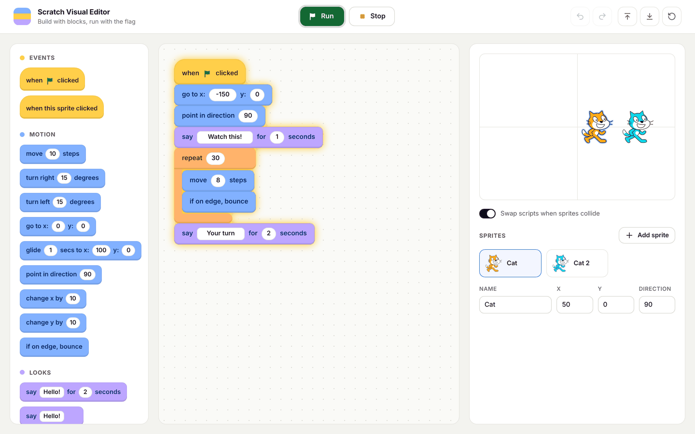

# Scratch Visual Editor

[](https://github.com/itsjxi/scratch-visual-editor/actions/workflows/ci.yml)

A Scratch-style visual programming editor in React and TypeScript. Drag blocks into scripts, press the green flag, and watch sprites move, glide, talk and bounce on the stage. Every edit can be undone, and the whole editor works with a keyboard and a screen reader.

**Live demo:** https://scratchanimation.netlify.app



## What it does

- **Real block programming.** There are 17 blocks across events, motion, looks and control: loops, `forever`, `glide`, `wait`, speech and thought bubbles, and `if on edge, bounce`. C-blocks hold other blocks, and blocks follow Scratch's attachment rules (nothing above a hat, nothing below `forever`).
- **A proper interpreter.** Each running script is a generator "thread". A scheduler resumes every thread once per animation frame, until it pauses at the end of a loop iteration, on each frame of a glide, or while waiting. Threads run side by side, Stop ends them instantly, and a script that never pauses can't freeze the page.
- **Drag and drop on pointer events.** It works with a mouse, touch and pen. A dragged block takes the blocks below it with it, like in Scratch. An insertion marker shows where it will land, including inside loops. Drop it on empty canvas to start a new script, or on the palette to delete it. Escape cancels a drag.
- **Undo and redo for everything:** adding, moving, deleting, editing values, sprites, renames and imports. Typing a number is one undo step, not one per keystroke. Deleting shows a toast with an Undo button.
- **Keyboard and screen-reader support.**
  - Press Enter on a palette block to add it.
  - Use the arrow keys to move between blocks, Alt+↑/↓ to reorder, and Delete to remove.
  - Ctrl/⌘+Z and Ctrl/⌘+Shift+Z undo and redo.
  - Sprites on the stage can be moved with the arrow keys.
  - Every change is announced in a live region.
  - axe-core finds zero violations.
- **Several sprites, and a collision swap.** When two sprites start touching, they swap the scripts they're running (the original assignment's twist). It can be turned off.
- **Autosave and project files.** Work is saved to `localStorage`, and you can download it or open it as JSON. Opened files are validated block by block, so a broken or hostile file is refused with a reason instead of crashing the editor.

## How it's built

```
src/
  model/      types, block definitions, immutable tree edits, project validation
  editor/     history (undo/redo) and the editor store
  runtime/    the interpreter: generator threads, frame scheduler, collisions
  ui/         React components, pointer drag and drop, stage, toast
```

- **The program is an immutable tree.** Every edit returns a new project that shares all untouched branches with the old one. That makes undo a stack of snapshots, with no inverse command to write for each edit. It also lets `React.memo` skip every block that didn't change.
- **State outside React.** The editor store, the runtime and the drag controller are small external stores read with `useSyncExternalStore`. While you drag, only the list under the pointer re-renders.
- **Time is an input.** `runtime.step(now)` takes the clock as an argument, so tests drive the interpreter frame by frame and are fully deterministic.

## Testing

```bash
npm test           # Vitest + Testing Library: 37 tests
npm run test:e2e   # Playwright: 6 end-to-end tests in Chromium
npm run lint       # ESLint, typescript-eslint, react-hooks
npm run typecheck  # strict TypeScript
```

- **Unit tests** cover:
  - tree edits and attachment rules
  - history, including coalescing and its size limit
  - project validation
  - the interpreter: loops yielding each frame, waits, glides, bouncing, Stop, a script that never yields, click hats, the collision swap, and a regression test for the old stale-position bug
- **Component tests** drive the real UI: adding blocks from the keyboard, reordering, deleting and undoing them, typing values, running, sprites, and refusing a broken file.
- **End-to-end tests** drag real blocks with a real pointer in Chromium: into a loop, onto the canvas, onto the palette to delete, then run, stop, and reload to check autosave.

CI runs all of it on every push.

## Getting started

```bash
npm install
npm run dev        # http://localhost:5173
```

## History

This began as a JavaScript/webpack take-home assignment. Version 2 is a rewrite in TypeScript with a new interpreter, immutable model, undo/redo, pointer drag and drop, accessibility, and tests. It also fixes the original's main bug: each block read a stale copy of the sprite, so two `move 10 steps` blocks moved it 10 steps instead of 20.
